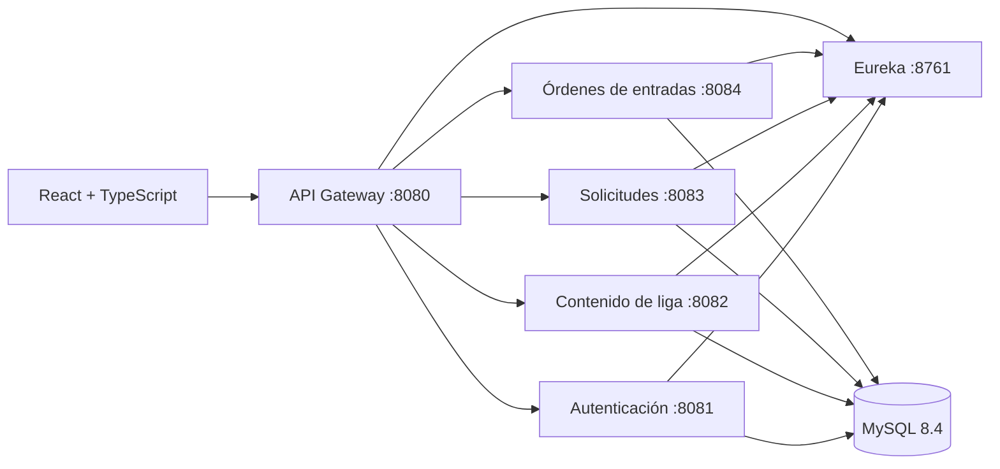

# LIF Store

Plataforma web de la Liga Independiente de Fútbol (LIF). Permite consultar la actividad de la liga, gestionar solicitudes y crear órdenes de entradas mediante una aplicación React conectada a una API Spring Boot.

## Documentación

| Guía | Contenido |
|---|---|
| [Backend](backend/README.md) | Microservicios, configuración, API y ejecución con Docker o Maven. |
| [Frontend](frontend/README.md) | Instalación, configuración, páginas y comandos de desarrollo. |

## Funcionalidades

- Consulta de partidos, posiciones, noticias, jugadores, actas y complejos deportivos.
- Registro, inicio de sesión, perfil de usuario y acceso con roles.
- Envío y seguimiento de solicitudes.
- Carrito de entradas y consulta de órdenes asociadas a la cuenta.
- Panel de administración para gestionar el contenido de la liga y las solicitudes.

Las órdenes de entradas se crean en estado `PENDIENTE_PAGO`. El proyecto todavía no integra un proveedor de pagos, por lo que no procesa cobros ni emite entradas pagadas.

## Arquitectura



El backend está compuesto por servicios Spring Boot independientes, un API Gateway y Eureka para descubrir servicios. MySQL almacena los datos; Flyway administra las migraciones de cada servicio. El frontend consume el Gateway mediante REST y autenticación JWT.

## Estructura del repositorio

```text
backend/
  api-gateway/       Enrutamiento y seguridad de entrada
  auth-service/      Usuarios y autenticación
  league-service/    Partidos, noticias y jugadores
  request-service/   Solicitudes
  tickets-service/   Órdenes de entradas
  eureka-server/     Descubrimiento de servicios
  shared/            Seguridad y componentes compartidos
frontend/
  lif-store-react/   Aplicación React activa
  legacy/            Fuentes anteriores conservadas
```

## Requisitos

- Git.
- Docker Desktop con Docker Compose v2 en Windows; Docker Engine y el plugin Docker Compose v2 en Linux.
- Node.js `20.19+` o `22.12+` y npm.
- Java 21 solo para compilar o ejecutar servicios fuera de Docker. Docker construye el backend con Maven y Java dentro de la imagen.

En Windows, inicia Docker Desktop y utiliza contenedores Linux (WSL 2 recomendado). En Linux, inicia Docker y asegúrate de que tu usuario pueda ejecutar el comando `docker`.

## Inicio rápido

Los comandos de Docker se ejecutan desde la raíz del repositorio, donde se encuentran `backend/` y `frontend/`.

### 1. Clonar el proyecto

```bash
git clone https://github.com/090Santander/lif-store.git
cd lif-store
```

### 2. Crear la configuración local

En PowerShell:

```powershell
Copy-Item backend/.env.example backend/.env
Copy-Item frontend/lif-store-react/.env.example frontend/lif-store-react/.env.local
```

En Linux:

```bash
cp backend/.env.example backend/.env
cp frontend/lif-store-react/.env.example frontend/lif-store-react/.env.local
```

Edita `backend/.env` y reemplaza las credenciales de ejemplo. Define contraseñas locales y un `JWT_SECRET` aleatorio de al menos 32 bytes. Configura también `LIF_ADMIN_EMAIL` y `LIF_ADMIN_PASSWORD` para crear la cuenta administradora local.

Los archivos `.env` y `.env.local` están excluidos de Git; conserva las credenciales únicamente en tu equipo.

### 3. Iniciar el backend

El mismo comando sirve en PowerShell y Linux:

```bash
docker compose --env-file backend/.env -f backend/docker-compose.yml up --build -d
```

La primera ejecución descarga imágenes y compila los servicios, por lo que puede tardar varios minutos. Comprueba su estado:

```bash
docker compose --env-file backend/.env -f backend/docker-compose.yml ps
```

### 4. Iniciar el frontend

Abre otra terminal desde la raíz del repositorio y ejecuta:

```bash
cd frontend/lif-store-react
npm ci
npm run dev
```

Visita <http://localhost:5173>. La aplicación usa por defecto el API Gateway en <http://localhost:8080/api>. Para entrar como administrador local, usa el correo y la contraseña definidos en `LIF_ADMIN_EMAIL` y `LIF_ADMIN_PASSWORD`.

## Direcciones locales

| Componente | Dirección |
|---|---|
| Aplicación web | <http://localhost:5173> |
| API Gateway | <http://localhost:8080/api> |
| Eureka | <http://localhost:8761> |
| Swagger de autenticación | <http://localhost:8081/swagger-ui.html> |
| Swagger de liga | <http://localhost:8082/swagger-ui.html> |
| Swagger de solicitudes | <http://localhost:8083/swagger-ui.html> |
| Swagger de entradas | <http://localhost:8084/swagger-ui.html> |

## Publicación en GitHub Pages

El workflow de GitHub Actions publica el frontend en <https://090santander.github.io/lif-store/> cuando se actualiza `main`; también se puede iniciar manualmente desde la pestaña **Actions**. La primera vez, selecciona **Settings → Pages → Build and deployment → GitHub Actions** como origen.

GitHub Pages solo aloja el frontend estático. Para habilitar autenticación y las funciones conectadas a la API, define `VITE_API_URL` como variable del repositorio en **Settings → Secrets and variables → Actions → Variables**. Debe apuntar a una API pública con HTTPS y permitir el origen `https://090santander.github.io` mediante CORS. Sin esa variable, el sitio carga y las funciones que requieren backend muestran un aviso de configuración.

## Comandos habituales

Desde `frontend/lif-store-react`:

```bash
npm run dev      # Servidor local de desarrollo
npm run lint     # Revisión estática
npm run build    # Compilación de producción en dist/
npm run test     # Pruebas del frontend con Karma y Jasmine
```

Desde la raíz del repositorio, para revisar los logs del API Gateway:

```bash
docker compose --env-file backend/.env -f backend/docker-compose.yml logs -f api-gateway
```

Detener los contenedores y conservar la base local:

```bash
docker compose --env-file backend/.env -f backend/docker-compose.yml down
```

Para eliminar también la base de datos local y sus órdenes, añade `-v` al comando `down`.

## Solución de problemas

- **Docker no responde:** inicia Docker Desktop en Windows o el servicio Docker en Linux; comprueba `docker compose version`.
- **Un puerto está ocupado:** libera los puertos `3306`, `5173`, `8080–8084` y `8761`, o ajusta las asignaciones en `backend/docker-compose.yml`.
- **La web no conecta con la API:** confirma que el backend esté iniciado y que `VITE_API_URL` apunte a `http://localhost:8080/api`.
- **El login responde 503:** revisa `docker compose --env-file backend/.env -f backend/docker-compose.yml logs --tail=120 auth-service mysql`. Si cambiaste `LIF_DB_PASSWORD` después de crear el volumen de MySQL, el usuario de la base conserva la contraseña anterior; restaura esa contraseña o actualízala dentro de MySQL.
- **Cambiaste dependencias de JavaScript:** vuelve a ejecutar `npm ci` dentro de `frontend/lif-store-react`.

---

Consulta también las guías específicas: [backend](backend/README.md) · [frontend](frontend/README.md).
