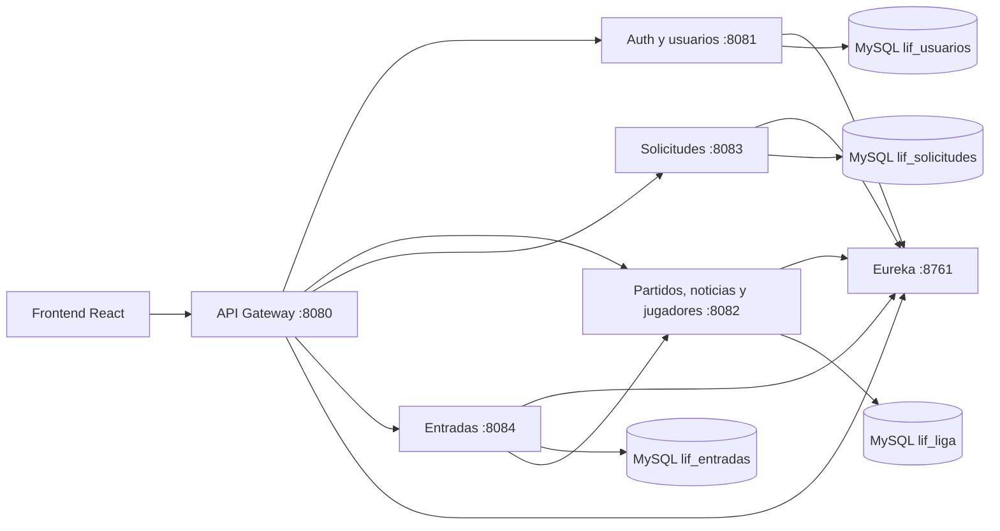

# Backend LIF Store

Backend REST de la Liga Independiente de Fútbol. Sigue el patrón de `gestionbibliotecas`: servicios Spring Boot independientes, Eureka para descubrimiento y un API Gateway como punto de entrada.

## Arquitectura



Cada servicio mantiene las capas `controller`, `service`, `repository`, `model` y `dto`. La configuración común de seguridad y errores está en `shared`; las tablas se crean y evolucionan con Flyway.

## Requisitos

- Java 21 y Maven 3.6.3+ para ejecutar servicios fuera de Docker.
- Docker Engine y Docker Compose para levantar la plataforma completa.

## Ejecución local con Docker

Ejecuta los comandos desde la raíz del repositorio, donde están las carpetas backend y frontend.

En PowerShell:

    Copy-Item backend/.env.example backend/.env

En Linux:

    cp backend/.env.example backend/.env

Edita backend/.env y reemplaza las contraseñas de ejemplo. JWT_SECRET debe tener al menos 32 bytes; define también LIF_ADMIN_EMAIL y LIF_ADMIN_PASSWORD. Después, en Windows o Linux, inicia la plataforma desde la raíz:

    docker compose --env-file backend/.env -f backend/docker-compose.yml up --build -d

Consulta el estado:

    docker compose --env-file backend/.env -f backend/docker-compose.yml ps

La URL base para el frontend es http://localhost:8080/api. El frontend React usa esa dirección por defecto; para cambiarla, configura VITE_API_URL en frontend/lif-store-react/.env.local y ejecuta npm run dev desde frontend/lif-store-react. Autenticación, solicitudes, contenido administrativo y órdenes usan estos endpoints; el carrito se conserva temporalmente en el navegador. Eureka queda en http://localhost:8761. Las interfaces Swagger de los servicios están disponibles en:

- Auth y usuarios: `http://localhost:8081/swagger-ui.html`
- Liga: `http://localhost:8082/swagger-ui.html`
- Solicitudes: `http://localhost:8083/swagger-ui.html`
- Entradas: `http://localhost:8084/swagger-ui.html`

Para detener los contenedores y conservar los datos de MySQL:

    docker compose --env-file backend/.env -f backend/docker-compose.yml down

Para borrar también la base local usa el mismo comando con -v. Esa acción elimina los usuarios y órdenes guardados en el volumen.

## Ejecución de un servicio desde el IDE

Levanta primero MySQL y Eureka con Docker, luego configura en el IDE estas variables para el servicio que ejecutarás:

```text
SPRING_DATASOURCE_URL=jdbc:mysql://localhost:3306/lif_usuarios?useSSL=false&allowPublicKeyRetrieval=true&serverTimezone=UTC
SPRING_DATASOURCE_USERNAME=lif_app
SPRING_DATASOURCE_PASSWORD=<LIF_DB_PASSWORD de .env>
EUREKA_URL=http://localhost:8761/eureka/
JWT_SECRET=<JWT_SECRET de .env>
```

Usa el esquema correspondiente al servicio (`lif_liga`, `lif_solicitudes` o `lif_entradas`) y configura `CORS_ALLOWED_ORIGINS` con el origen de Vite. Para tickets agrega `LEAGUE_SERVICE_URL=http://localhost:8082`.

## Autenticación y permisos

- `POST /api/auth/register` crea una cuenta de rol `usuario`; el rol no se acepta desde el cliente.
- `POST /api/auth/login` devuelve un token Bearer firmado con HS256 y el perfil del usuario.
- `GET /api/auth/me` y `GET /api/usuarios/me` devuelven el perfil del token.
- El usuario administrador inicial se crea desde `LIF_ADMIN_EMAIL` y `LIF_ADMIN_PASSWORD` al iniciar `auth-service`.
- Consultas públicas: partidos, noticias y jugadores. Crear, editar y borrar contenido requiere el rol `ADMIN`.
- Solicitudes y órdenes de entradas se filtran por el usuario autenticado; las acciones de administración requieren `ADMIN`.
- La contraseña se guarda con BCrypt. El backend no procesa ni almacena datos de tarjetas.

El secreto de ejemplo de `application.yml` sirve únicamente para ejecución manual local. Cambia `JWT_SECRET` para cualquier entorno compartido o desplegado. Debe tener al menos 32 bytes y coincidir entre gateway y servicios.

## API principal

| Método | Ruta | Acceso | Acción |
|---|---|---|---|
| POST | `/api/auth/register` | Público | Registro |
| POST | `/api/auth/login` | Público | Inicio de sesión |
| GET | `/api/auth/me` | Usuario | Perfil actual |
| GET, POST | `/api/partidos` | Público, Admin | Consultar o crear partidos |
| GET, PUT, DELETE | `/api/partidos/{id}` | Público en GET, Admin en cambios | Administrar un partido |
| GET, POST | `/api/noticias` | Público, Admin | Consultar o publicar noticias |
| GET, PUT, DELETE | `/api/noticias/{id}` | Público en GET, Admin en cambios | Administrar noticia |
| GET, POST | `/api/jugadores` | Público, Admin | Consultar o registrar jugadores |
| GET, PUT, DELETE | `/api/jugadores/{id}` | Público en GET, Admin en cambios | Administrar jugador y estadísticas |
| POST | `/api/solicitudes` | Usuario | Crear una solicitud |
| GET | `/api/solicitudes/mias` | Usuario | Listar solicitudes propias |
| GET | `/api/solicitudes` | Admin | Listar todas las solicitudes |
| PATCH | `/api/solicitudes/{id}/estado` | Admin | Aprobar o rechazar |
| POST | `/api/entradas/compras` | Usuario | Crear una orden de entradas |
| GET | `/api/entradas/mias` | Usuario | Ver órdenes propias |
| GET | `/api/entradas` | Admin | Ver todas las órdenes |

Ejemplo de registro (el RUN se valida con módulo 11):

```json
{
  "run": "190110222",
  "correo": "persona@ejemplo.cl",
  "nombre": "Camila",
  "apellidos": "Pérez Soto",
  "clave": "una-clave-segura"
}
```

Ejemplo de compra. El precio se consulta en el servicio de partidos; el cliente no puede fijarlo en la solicitud:

```json
{
  "entradas": [
    { "partidoId": 1, "cantidad": 2 }
  ]
}
```

El resultado queda en estado `PENDIENTE_PAGO`. Para aceptar pagos reales se debe integrar un proveedor de pagos y confirmar la orden con su notificación firmada.

## Construcción

Empaquetar todos los módulos sin ejecutar pruebas:

```bash
./mvnw -DskipTests package
```

Los servicios exponen `GET /actuator/health`. Los endpoints y modelos REST se documentan con OpenAPI/Swagger.
