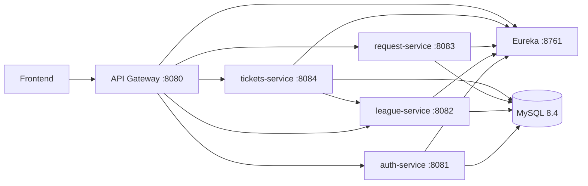

# Backend · LIF Store

API REST para la Liga Independiente de Fútbol. El backend implementa servicios Spring Boot separados por dominio, registro de servicios con Eureka y un API Gateway como punto de acceso para el frontend.

[Volver al README principal](../README.md) · [Guía del frontend](../frontend/README.md)

## Arquitectura



Los servicios de dominio están organizados en capas `controller`, `service`, `repository`, `model` y `dto`. El módulo `shared` contiene elementos comunes de seguridad y manejo de errores. Cada servicio de dominio administra su propio esquema y sus migraciones con Flyway.

## Tecnologías

- Java 21 y Spring Boot 4.
- Spring Cloud, Eureka y Spring Cloud Gateway.
- Spring Security y tokens JWT.
- Spring Data JPA, MySQL 8.4 y Flyway.
- Maven Wrapper y Docker Compose.
- OpenAPI/Swagger para explorar los servicios REST.

## Servicios

| Módulo | Puerto | Responsabilidad | Base de datos |
|---|---:|---|---|
| `eureka-server` | 8761 | Registro y descubrimiento de servicios. | — |
| `api-gateway` | 8080 | Entrada REST, enrutamiento, JWT y CORS. | — |
| `auth-service` | 8081 | Registro, inicio de sesión, usuarios y roles. | `lif_usuarios` |
| `league-service` | 8082 | Partidos, noticias y jugadores. | `lif_liga` |
| `request-service` | 8083 | Creación y gestión de solicitudes. | `lif_solicitudes` |
| `tickets-service` | 8084 | Órdenes de entradas y consulta de precios de partidos. | `lif_entradas` |

## Requisitos

Para levantar la plataforma completa:

- Docker Desktop y Docker Compose v2 en Windows, o Docker Engine y Docker Compose v2 en Linux.
- Conexión a Internet durante la primera compilación para descargar imágenes y dependencias.

Para compilar desde el equipo con Maven Wrapper también se requiere Java 21. Maven se descarga mediante el wrapper.

## Configuración local

Ejecuta los comandos desde la raíz del repositorio.

PowerShell:

```powershell
Copy-Item backend/.env.example backend/.env
```

Linux:

```bash
cp backend/.env.example backend/.env
```

Edita `backend/.env` antes de iniciar el backend:

| Variable | Uso |
|---|---|
| `MYSQL_ROOT_PASSWORD` | Contraseña de administración de MySQL. |
| `LIF_DB_PASSWORD` | Contraseña del usuario de aplicación `lif_app`. |
| `JWT_SECRET` | Secreto compartido por el Gateway y los servicios; mínimo 32 bytes. |
| `CORS_ALLOWED_ORIGINS` | Orígenes autorizados, separados por comas. Por defecto permite Vite local. |
| `LIF_ADMIN_EMAIL` | Correo de la cuenta administradora inicial. |
| `LIF_ADMIN_PASSWORD` | Contraseña de la cuenta administradora inicial. |

Usa valores locales propios y no publiques el archivo `backend/.env`.

## Ejecutar toda la plataforma

Desde la raíz del repositorio, el comando es igual en PowerShell y Linux:

```bash
docker compose --env-file backend/.env -f backend/docker-compose.yml up --build -d
```

Ver el estado de los contenedores:

```bash
docker compose --env-file backend/.env -f backend/docker-compose.yml ps
```

Seguir los logs de un servicio:

```bash
docker compose --env-file backend/.env -f backend/docker-compose.yml logs -f api-gateway
```

Los servicios se conectan a un volumen persistente de MySQL. Para detenerlos y conservar los datos:

```bash
docker compose --env-file backend/.env -f backend/docker-compose.yml down
```

Para eliminar también el volumen local de MySQL, utiliza `down -v`. Esto borra los datos locales de la base.

## Endpoints

El frontend consume la API a través de `http://localhost:8080/api`. Las interfaces Swagger se sirven directamente desde cada servicio:

| Servicio | Swagger | Salud |
|---|---|---|
| Autenticación | <http://localhost:8081/swagger-ui.html> | <http://localhost:8081/actuator/health> |
| Liga | <http://localhost:8082/swagger-ui.html> | <http://localhost:8082/actuator/health> |
| Solicitudes | <http://localhost:8083/swagger-ui.html> | <http://localhost:8083/actuator/health> |
| Entradas | <http://localhost:8084/swagger-ui.html> | <http://localhost:8084/actuator/health> |
| Eureka | <http://localhost:8761> | <http://localhost:8761/actuator/health> |
| API Gateway | — | <http://localhost:8080/actuator/health> |

### API principal

| Método | Ruta | Acceso | Descripción |
|---|---|---|---|
| `POST` | `/api/auth/register` | Público | Registrar una cuenta de usuario. |
| `POST` | `/api/auth/login` | Público | Iniciar sesión y obtener JWT. |
| `GET` | `/api/auth/me` | Usuario | Consultar el perfil autenticado. |
| `GET`, `POST` | `/api/partidos` | Público, Admin | Listar partidos; crear requiere rol `ADMIN`. |
| `GET`, `PUT`, `DELETE` | `/api/partidos/{id}` | Público, Admin | Consultar; modificar requiere rol `ADMIN`. |
| `GET`, `POST` | `/api/noticias` | Público, Admin | Listar noticias; crear requiere rol `ADMIN`. |
| `GET`, `PUT`, `DELETE` | `/api/noticias/{id}` | Público, Admin | Consultar; modificar requiere rol `ADMIN`. |
| `GET`, `POST` | `/api/jugadores` | Público, Admin | Listar jugadores; crear requiere rol `ADMIN`. |
| `GET`, `PUT`, `DELETE` | `/api/jugadores/{id}` | Público, Admin | Consultar; modificar requiere rol `ADMIN`. |
| `POST` | `/api/solicitudes` | Usuario | Crear una solicitud. |
| `GET` | `/api/solicitudes/mias` | Usuario | Listar solicitudes propias. |
| `GET` | `/api/solicitudes` | Admin | Listar todas las solicitudes. |
| `PATCH` | `/api/solicitudes/{id}/estado` | Admin | Cambiar el estado de una solicitud. |
| `POST` | `/api/entradas/compras` | Usuario | Crear una orden de entradas. |
| `GET` | `/api/entradas/mias` | Usuario | Consultar órdenes propias. |
| `GET` | `/api/entradas` | Admin | Consultar todas las órdenes. |

Los recursos `/api/usuarios` permiten consultar usuarios para administración; `/api/usuarios/me` devuelve el perfil del usuario autenticado.

## Autenticación y reglas de negocio

- Los endpoints protegidos reciben `Authorization: Bearer <token>`.
- Las contraseñas se almacenan con BCrypt. El rol de la cuenta creada por registro lo asigna el backend.
- El registro valida el RUN chileno. El usuario administrador inicial se configura mediante `LIF_ADMIN_EMAIL` y `LIF_ADMIN_PASSWORD`.
- Las solicitudes y órdenes se consultan según la identidad del token; el rol `ADMIN` permite las operaciones administrativas.
- El servicio de entradas obtiene los precios desde el servicio de liga; no confía en el precio enviado por el navegador.
- La orden se crea como `PENDIENTE_PAGO`. No hay integración con proveedor de pagos ni almacenamiento de datos de tarjetas.

## Compilar con Maven Wrapper

Desde `backend/`:

PowerShell:

```powershell
.\mvnw.cmd -DskipTests package
```

Linux:

```bash
./mvnw -DskipTests package
```

Los artefactos compilados quedan en el directorio `target/` de cada módulo.

## Estructura

```text
backend/
  api-gateway/
  auth-service/
  eureka-server/
  league-service/
  request-service/
  shared/
  tickets-service/
  docker/mysql/init/  Scripts de inicialización de esquemas
  docker-compose.yml
  Dockerfile
  pom.xml
```

---

[README principal](../README.md) · [Guía del frontend](../frontend/README.md)
